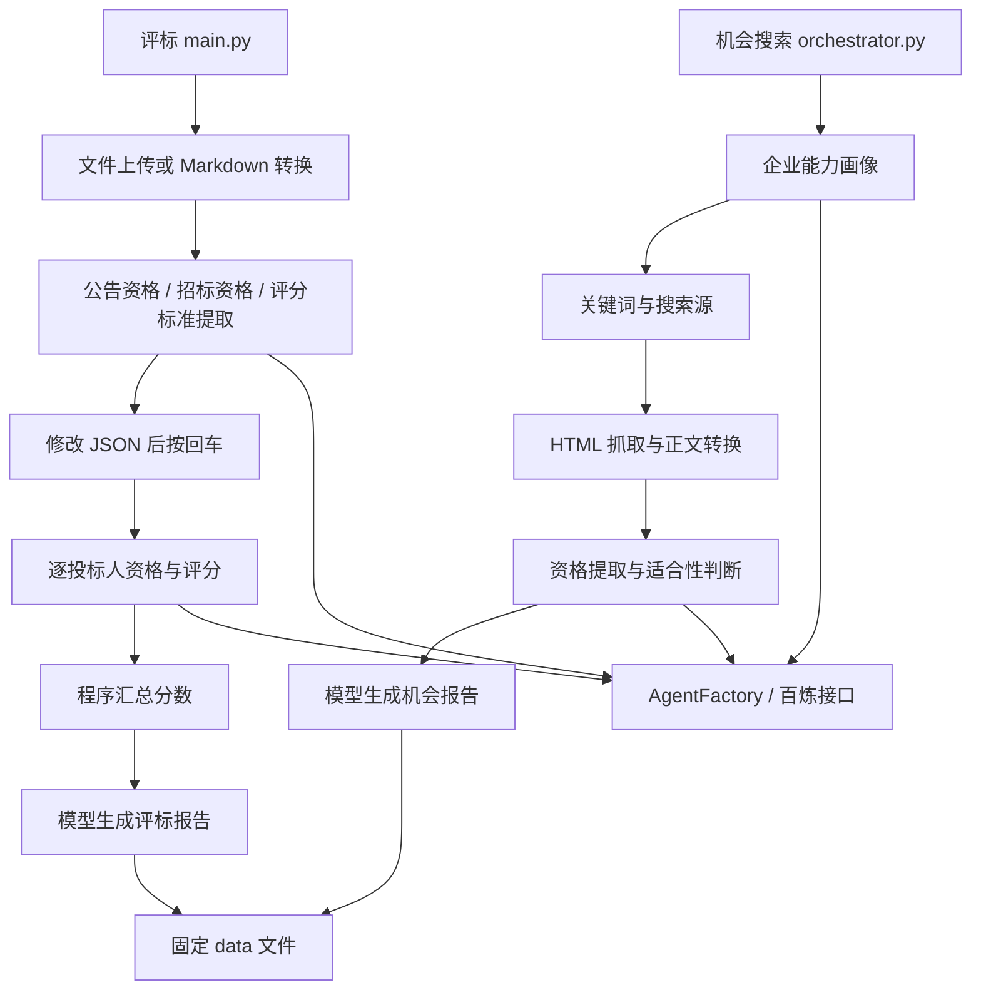
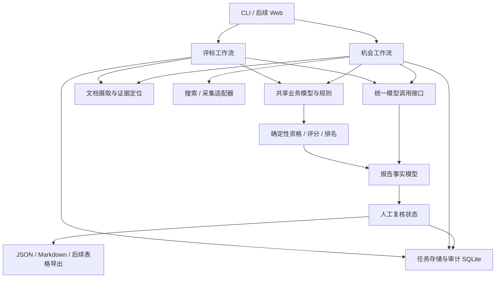

# AI 招投标评审与机会搜索完善计划（Implementation Plan）

> **方案选择更新（2026-10-02）：** 用户已采用方案二，并建议后端使用 FastAPI、后续可能开发 React 前端。以下保留原始评估与备选路线；后续以 [FastAPI 后端修复计划](2026-10-02-fastapi-backend-repair-plan.md) 为实施规划依据。方案选择不代表已授权执行。

> 状态：待评审，全部实施任务未执行。此次仅完成代码分析、GitHub 调研和离线验证，并新增本文档。未修改业务代码、未安装依赖、未调用付费模型、未部署。
> 后续执行者：须在用户另行要求实施后，按任务逐项执行；可采用 `superpowers:executing-plans`。本文不构成执行授权。

**Goal:** 保留现有评标和机会搜索能力，优先修复可能改变结论的错误，再建立可追溯、可恢复、可扩展的辅助评审系统。

**Architecture:** 推荐渐进式模块化单体。CLI 负责交互，评标与机会搜索工作流负责编排，共享文档、模型、规则、存储和审计接口。资格判定、数值计算、过滤和排名由程序控制，模型负责信息提取与分析说明，人工确认形成可记录的状态。

**Tech Stack:** 当前 Python、百炼兼容接口、OpenAI SDK、agent-framework、MarkItDown、HTTPX、BeautifulSoup；计划保留 Python，增加 Pydantic 数据契约与 SQLite，OCR 和 Web UI 分阶段选型。

**Spec:** 本文第 1–5 节为架构评估与建议设计，第 6–8 节为实施计划和验收要求；均为建议稿。

**调研日期：** 2026-10-02（UTC+8）。

## 全局约束

- 本次只交付分析与计划，所有任务状态均为“未执行”。
- 后续先以 Windows、Python 3.11 为验证基线；当前另有 Python 3.13 虚拟环境痕迹，其兼容性未验证。
- 保留“资格不通过仍可展示参考评分，但不得推荐”的现有业务意图。
- 保留企业投标信息摘要用于机会粗筛；将“摘要粗筛”和“完整材料审查”标记为不同模式。
- 不把缺失信息自动解释为通过或不通过；无法确认时进入人工复核。
- 对数值、标识、资格状态、排名、证据引用做程序校验，不能仅依靠提示词。
- 先保留百炼适配；不因参考项目使用其他服务商而迁移现有服务商。
- GitHub 项目的功能描述以仓库文档为依据，仅抽查部分源码，没有运行或审计其完整系统。

## 重点复核场景

1. 否定语义、缺失资格字段、未知状态被误判为可投标：由 T01、T02、T03 覆盖。
2. 上传失败、空文档、扫描件、长文档导致模型无依据评审：由 T01、T05 覆盖。
3. 人工删除或重排结果、候选缺少资格、多个任务覆盖产物：由 T01、T06 覆盖。
4. 分数越界、价格公式缺参数、父子满分冲突、模型报告改写排名：由 T03 覆盖。
5. 过期或非招标公告、预算未知、来源异常、单个候选失败：由 T07、T08、T09 覆盖。

## 1. 结论与适用范围

**现有分层适合原型验证和小规模人工辅助使用，但还不足以支撑稳定的批量业务。建议保留并逐步完善，优先保障结论正确性。**

项目名称和代码表明有两条不同业务链：

- 评标链：公告和招标文件提取 → 人工核对 → 公告资格审查 → 招标文件资格审查 → 评分 → 报告。
- 机会链：投标材料 → 企业画像 → 关键词 → 搜索 → 公告抓取 → 资格提取 → 适合性评估 → 报告。

这里的“多 Agent”主要是多个专用提示词任务，由入口按固定顺序调用；现阶段不需要为了名称引入自主多 Agent 调度。

### 1.1 合理之处

| 设计 | 判断 | 保留建议 |
|---|---|---|
| `src/ai_bid_evaluator` 包结构 | 业务模块集中，入口明确 | 保留包名和现有入口兼容性 |
| `agents` / `prompts` / `services` / `utils` 分离 | 有利于替换提示词与模型调用 | 在此基础上增加明确数据契约 |
| 资格提取与评分提取分开 | 能减少把资格门槛误当评分项的问题 | 保留分工，用统一规则模型关联 |
| 搜索源 `SearchProvider` 协议 | 是可扩展的良好基础 | 新来源继续通过适配器接入 |
| 原始 HTML、Markdown 和中间 JSON 留存 | 便于排错和人工核对 | 增加任务 ID、版本和证据定位 |
| 人工检查点和机会三态结论 | 有助于控制不确定结果 | 将终端暂停升级为持久化复核状态 |
| 程序重算分数总和 | 比直接接受模型总分更稳妥 | 增加规则与上下界校验 |

### 1.2 架构方向的比较

| 方案 | 优点 | 代价 | 建议 |
|---|---|---|---|
| 继续保持当前脚本结构，仅补错误 | 起步快 | 运行恢复、多人操作、产物隔离仍薄弱 | 仅作为 P0 过渡阶段 |
| 模块化单体 + 任务状态 + SQLite | 保留现有代码，边界清楚，适合本地与小团队 | 需要引入统一模型和状态存储 | **推荐** |
| 微服务 + 消息队列 + 向量库 + 多租户 | 可支持更大规模 | 运维和一致性成本高，当前需求未证实 | 等有明确负载或组织需求再考虑 |

目前没有看到独立 Web/API 服务、多用户权限或明确大规模并发要求，不建议立即扩展成平台级架构。

## 2. 现有结构与数据流



主要问题在于：入口同时承担文件转换、模型调度、人工交互、业务规则与存储；工作流状态没有独立模型；模型输出主要以自由 `dict` 在模块间流转。

## 3. 已发现问题与证据

优先级含义：P0 = 可能改变结论或丢失复核结果，首先修复；P1 = 稳定性、可追溯性和可扩展性；P2 = 产品体验与后续能力。

### 3.1 必须优先处理

| 编号 | 优先级 | 发现 | 代码证据 | 影响 / 建议 |
|---|---|---|---|---|
| F01 | P0 | 非标准否定状态被归一化成“适合投标” | `search_opportunity/suitability_agent.py:49` 先匹配“推荐/可行/适合”，随后才匹配否定；补充离线检查已复现 | `不推荐`、`不可行`、`不适合参与投标` 会误推荐；采用明确状态映射，歧义进入复核 |
| F02 | P0 | 公告和招标文件的本地兜底内容未进入提取链 | `main.py:78,87` 保存 Markdown；`:114,124,130` 后续仍只传文件 ID；两个招标提取器没有 Markdown 参数 | 上传失败后可能以无文档输入继续请求；统一输入载体并禁止空输入调用 |
| F03 | P0 | 评分校验标志恒为真 | `utils/score_utils.py:45,47`；补充检查中 20/10、-1/10 都标记有效 | 没有检查越界、规则树一致性、漏项或重复项；按已确认的评分规则校验 |
| F04 | P0 | “未提取到资格”的复核结果在报告输入中丢失 | `orchestrator.py:161` 仅写 `candidate.suitability`，随后 `continue`；只有 `:180` 加入结果列表；`models.py:32` 序列化不包含 suitability | 日志说已标记，但最终报告只收到候选状态和其他结果，无法可靠保留该复核点 |
| F05 | P0 | 人工编辑结果按数组位置关联投标人 | `main.py:193–198` 只检查长度并使用 `qualification_results[i]` | 同长度重排会将 A 的资格用于 B 的评分；数量错误复查后仍可能越界；以稳定 ID 关联 |
| F06 | P0 | 资格与报告数据契约不统一 | 资格提示词使用 `all_passed`、`document_info.bidder`；评分引用使用三态 `qualification_status`；报告提示词排序用 `final_score`，评分实际输出 `total_score` | 模型自行转换字段和判断状态；建立统一模型、规则和报告汇总 |
| F07 | P0 | 评标报告提示词中的示例 JSON 语法错误 | `prompts/report_prompt.py:31` 附近 `company_analysis` 数组结束后缺逗号；提取示例后 `json.loads` 失败 | 可能诱导无效 JSON；用结构化模型生成示例或做提示词契约检查 |
| F08 | P0 | 资格文本输出把缺失字段解释为“不通过” | `utils/qualification_text_generator.py:29,33,69` 将缺失字段默认 False | 无法表达“未知 / 需人工复核”，输出可能与审查说明冲突；统一三态渲染 |

以上 F02、F04、F05、F06、F08 基于静态控制流和字段检查；本次没有启动真实评标链验证模型行为。F01、F03、F07 已通过本地无网络检查复现。

### 3.2 可靠性与业务完整性

| 编号 | 优先级 | 发现 | 代码证据 | 建议 |
|---|---|---|---|---|
| F09 | P1 | 输入的候选上限未生效 | `orchestrator.py:84` 计算局部 `max_candidates` 后未使用；SearchService 从 settings 取上限 | 显式传入本次搜索请求，不依赖全局配置 |
| F10 | P1 | 地域和预算只参与查询词，没有确定性过滤 | `keywords.py` 仅拼词；预算词排在后面，默认 4 条截断可能丢弃 | 从公告提取地域和金额后过滤；未知值进入待核实列表 |
| F11 | P1 | 不区分招标、中标、更正、终止公告，也不判截止时间 | 标题与正文关键词范围宽；搜索近一年；候选模型没有公告类型、截止时间 | 添加统一公告模型和生命周期判断 |
| F12 | P1 | URL 去重粗糙，搜索来源丢失 | `searcher.py:206` 将完整 URL 小写；`:236` provider 设为空 | 域名规范化、保留路径大小写与业务参数；保留所有来源，增加项目编号去重 |
| F13 | P1 | 固定文件名和 `c01` 等 ID 跨运行重复 | 两个入口输出固定 data 文件；爬虫按 candidate_id 保存 HTML/Markdown/index | 用 run_id 隔离任务，稳定公告 ID 存历史 |
| F14 | P1 | 缺少统一断点续跑和部分失败处理 | 人工 `input()` 内嵌入口；候选逐项调用无统一任务异常隔离 | 分阶段存状态，失败候选单独记载，可重试失败项 |
| F15 | P1 | JSON 可解析不等于业务有效 | `json_utils.py:55` 声明返回 dict，实际能返回 list；缺少 Schema 验证 | Pydantic 严格校验、ID 对齐、分值和证据校验 |
| F16 | P1 | 模型错误处理分散且有限 | 文档路径仅处理 JSONDecodeError 和特定文件解析提示；文本路径无应用层重试策略 | SDK 重试与应用重试协调；统一超时、限流、输出校验与错误分类 |
| F17 | P1 | 整篇文本输入，缺少页码与表格定位、显式 OCR 兜底和分块 | `markdown_loader.py` 只调用 MarkItDown；机会链超 100 万字符只提示 | 先检测可解析质量，再按文档结构切块；带证据定位进入模型 |
| F18 | P1 | 企业画像每次从单份文件重新抽取 | 机会入口只取第一个投标人 | 独立企业档案、材料增量更新、版本和证书有效期 |
| F19 | P1 | 工程可复现性不足 | 无 README、pyproject、锁文件；requirements 无版本；直接导入 bs4、lxml、httpx 却未显式列为直接依赖；pytest 未安装 | 建立安装说明、开发依赖、版本锁和离线 CI |
| F20 | P1 | 大部分关键规则由提示词承担 | 资格、强制项、参考评分和报告推荐主要交给模型 | 规则计算 / 模型说明分开；报告不得改变程序已确认结论 |

当前目录不是 Git 工作树，未发现可用 Git 历史或项目 AGENTS.md。本次只依据可见文件评估，不能判断过去的设计决策、线上运行表现或生产负载。

## 4. GitHub 同类项目与可借鉴功能

**找到了与两条业务链分别相近的项目。本次检索中，没有确认一个能直接替代当前“中国工程招投标评审 + 企业机会搜索”完整业务的成熟项目。** 下表的“适配程度”和采用顺序属于本次评估建议。

| 项目 / 类型 | 与本项目相近之处 | 值得借鉴 | 拟对应任务 | 限制与许可信息 |
|---|---|---|---|---|
| [God Biao / 神奇阿标](https://github.com/hello-fengsir/godbiao)，中文标书审查 | 上传标书、逐项响应核查、商务信息提取 | 解析预览、表格与内嵌图片 OCR、阶段进度、历史记录 | T05、T09、T12 | Python 系统，适配度高；仓库标注 MIT；其格式评价和制标功能不等同于工程评分规则 |
| [OpenRFP](https://github.com/CopelandBEC/openrfp)，RFP 评审 | 评分标准、供应商评分、比较和人工改分 | 每项分数关联原文、横向对照、修改分数后提示排名过期、导出 | T03、T09、T12 | MIT；文本评审为主，仓库明确尚未充分验证大型 RFP；其自动生成权重的做法不适用于擅自修改现有招标评分标准 |
| [TenderEval AI](https://github.com/sridhar7601/tendereval-ai)，资格评审示例 | 资格条件提取与投标材料比对 | 满足 / 不满足 / 需复核三态、条款级说明、审查签字式报告 | T02、T05、T09 | 黑客松项目，仓库根页未见 LICENSE，复用代码前需进一步确认；功能可靠性未实测 |
| [BidPilot](https://github.com/GiorgosPanagopoulos/bidpilot)，企业机会匹配 | 企业画像、招标采集、资格筛选 | 语义召回与规则排序分开、可配置资格引擎、提示词版本、用量记录 | T07、T10、T11 | MIT；主要对接欧洲数据源，本地需另写中国来源适配器 |
| [BiddingInformation](https://github.com/zero01221/BiddingInformation)，中文公告监测 | 多来源招标采集与筛选 | 公告类型分类、日期筛选、SQLite 历史去重、仅新增通知 | T08、T13 | 仓库标注 GPL-3.0；优先借鉴设计，直接并入代码前需确认使用与发布条件 |
| [BidMonitor-AI](https://github.com/zhiqianzheng/BidMonitor-AI)，中文招标监测 | 多站点采集、关键词和 AI 筛选 | 包含 / 排除关键词、可选 AI 过滤、桌面或 Web 配置 | T08、T12、T13 | 仓库 README 标注 MIT；不将“绕过反爬”作为本项目验收目标，采集能力需逐站验证 |
| [BidIQ](https://github.com/ShamirAli55/BidIQ)，能力库与响应 | 要求提取、企业能力匹配 | 历史业绩能力库、事实核查与语义匹配分流 | T11 | README 标注 MIT；其胜率模型依赖历史数据，不建议当前加入胜率承诺 |
| [Docling](https://github.com/docling-project/docling)，文档组件 | 补足文档解析基础 | 页面结构、表格、OCR、统一文档表示 | T05 | 代码 MIT，模型许可单独确认；需对中文工程材料和 Windows 环境实测 |

### 4.1 抽查源码得到的额外判断

- [God Biao parser.py](https://github.com/hello-fengsir/godbiao/blob/main/parser.py) 确实包含 PDF 页码标记、表格提取和中文 OCR。也把旧 `.doc` 送入 docx 解析路径，并将部分解析错误写成字符串返回；可借鉴证据分层思路，不宜直接复制所有实现。
- [BidPilot eligibility.py](https://github.com/GiorgosPanagopoulos/bidpilot/blob/main/app/matching/eligibility.py) 确实将金额、截止时间和排除项放进程序规则，配置带版本。但其中预算 / 营收倍数及准备天数是该项目业务设定，不应直接移植为本项目资格标准。
- OpenRFP 和其他仓库的功能主要依据 README 调研；部分 GitHub 目录请求失败，未据此假定相应源码已经验证。

优先借鉴顺序：**God Biao 的文档与审查体验 → OpenRFP 的证据和改分一致性 → BidPilot 的规则边界 → 中文公告监测项目的采集、分类和去重。**

## 5. 建议目标架构



边界要求：

1. **入口**负责参数和交互，不负责业务判定。现有两个入口兼容保留，逐步委托给工作流。
2. **模型调用**返回经过 Schema 校验的结果；模型服务商差异封装在适配器，文档文件 ID 与本地文本输入保持同一业务含义。
3. **规则**接收已经核对的条款与证据，计算状态、评分和排名。任何资格缺失、分数异常或强制项冲突均明确进入复核。
4. **存储**区分项目、企业、投标人、公告与运行任务；建议任务产物写入 `data/runs/<run_id>/`，不可用显示名称直接构造路径。
5. **人工复核**记录修改前后值、理由、时间、操作者和版本；修改上游材料后，将下游评分和报告标为过期。
6. **证据**至少包含文件哈希、文档 ID、页码或工作表 / 行列、文本块 ID、原文摘录。扫描证据带 OCR 质量信息。
7. **报告**由程序生成资格、分数、排名、引用链接和异常列表；模型只补充可核对的分析文字。

### 5.1 建议文件职责

所有下列目录均为未来建议，当前未创建业务模块。

```text
src/ai_bid_evaluator/
  main.py / search_opportunity_main.py     兼容入口
  workflows/
    bid_evaluation.py                     评标编排
    opportunity_discovery.py              机会编排
  domain/
    documents.py                          文档与证据模型
    evaluation.py                         条款、资格、评分与评标输入模型
    opportunity.py                        机会请求、公告、匹配结果模型
    run.py                                运行与复核状态模型
  services/
    document_ingestion.py                 转换、OCR、分块入口
    llm_gateway.py                        类型化模型接口
    agent_client.py                       百炼兼容适配与旧接口桥接
    bailian_file_service.py               文件服务适配
    review_service.py                     复核提交与版本失效
  rules/
    qualification.py                     三态判定和强制项规则
    scoring.py                           分值计算与规则树校验
    ranking.py                           排名和资格推荐限制
    opportunity_filter.py                公告类型、时间、地域、预算过滤
  repositories/
    sqlite_store.py                      任务、版本和审计存储
    artifact_store.py                    安全路径与原子文件写入
  reporting/
    bid_report.py                        评标事实汇总与渲染
    opportunity_report.py                机会事实汇总与渲染
  search_opportunity/
    searcher.py / crawler.py              保留接口并逐步拆分来源实现
    providers/                           来源适配器
  agents/ / prompts/                     专用提取与分析任务
tests/
  unit/ integration/ fixtures/           离线单元、模拟全链与脱敏样本
```

## 6. 完善计划表

工期为单名熟悉 Python 的开发者的粗略开发人日，含任务内测试，不含等待真实样本、外部接口授权或用户评审。OCR、站点变化和真实文档质量会影响估算。依赖编号表示验收前置关系；没有排入实际日历。

| ID | 阶段 | 任务 / 交付物 | 对应发现或借鉴 | 依赖 | 估算人日 | 验收重点 | 状态 |
|---|---|---|---|---|---|---|---|
| T01 | P0 | 修复否定状态、文档兜底、结果关联及复核遗漏 | F01、F02、F04、F05、F09 | 无 | 1–2 | 否定不误推荐；本地文档进入提取；重排不串投标人；所有复核保留 | 未执行 |
| T02 | P0 | 统一输入 / 输出 Schema 和三态资格，补工程基线 | F06、F07、F08、F15、F19 | T01 | 2–3 | 缺字段和错 ID 被拦截；示例 JSON 有效；可安装、可离线测试 | 未执行 |
| T03 | P0 | 确定性评分、资格推荐限制和报告事实汇总 | F03、F20；OpenRFP | T02 | 2–3 | 越界不通过；规则缺参数复核；失败资格不推荐；模型不能改分改排名 | 未执行 |
| T04 | P0 | 两条工作流的离线故障回归集 | 全部 P0 | T01–T03 | 1–2 | 模拟上传失败、JSON 错误、重排、候选异常，无网络跑完整链 | 未执行 |
| T05 | P1 | 统一文档摄取、OCR / 表格定位与长文档分块 | F17；God Biao / Docling | T02、T04 | 3–5 | 扫描件不静默空解析；长文档无静默截断；证据能定位 | 未执行 |
| T06 | P1 | 工作流拆分、任务隔离、断点恢复与复核版本 | F13、F14；OpenRFP | T03、T04 | 3–4 | 两任务无覆盖；恢复不重跑已确认步骤；改材料使下游过期 | 未执行 |
| T07 | P1 | 公告模型和确定性机会过滤 | F10、F11；BidPilot | T02、T04 | 2–3 | 过期和中标公告不推荐；地域预算严格过滤；未知进入复核 | 未执行 |
| T08 | P1 | 搜索源扩展、来源溯源、稳定去重与采集诊断 | F12；中文监测项目 | T06、T07 | 2–4 | 跨源同项目关联；区分无结果与源失败；中文乱码可诊断 | 未执行 |
| T09 | P1 | 逐条证据矩阵、报告一致性与审计导出 | God Biao / OpenRFP / TenderEval | T03、T05、T06 | 3–4 | 每项结论关联证据或缺证原因；人工改分可追溯；排名更新 | 未执行 |
| T10 | P1 | 模型调用统一重试、用量、日志和缓存 | F16；BidPilot | T02、T06 | 2–3 | 限流 / 超时可分类；坏 JSON 有界重试；缓存按版本失效 | 未执行 |
| T11 | P1 | 企业能力档案、多材料和证书时效 | F18；BidPilot / BidIQ | T05、T06、T09 | 2–3 | 同企业增量更新；冲突人工确认；材料有效期影响匹配 | 未执行 |
| T12 | P2 | 最小 Web 工作台：上传、证据核对、复核、比较 | God Biao / OpenRFP | P0、T06、T09 | 4–6 | 正文与条款并排；改分理由必填；可看任务进度与历史 | 未执行 |
| T13 | P2 | 增量监测、订阅筛选和仅新增通知 | BiddingInformation / BidMonitor | T06–T08、T10 | 2–3 | 同公告不重复通知；更正单独提醒；接收渠道默认未启用 | 未执行 |

阶段估算：P0 约 **6–10 人日**；P1 约 **17–26 人日**；P2 约 **6–9 人日**；全量约 **29–45 人日**。建议先完成并验收 P0，再用真实样本决定 P1 的 OCR 和来源范围；P2 是否实施由使用方式决定。

## 7. 任务接口、文件范围与验收步骤

以下函数、类型和文件名是后续实施建议，不代表现有接口已具备这些能力。未实现类型的责任任务在此明确列出，后续任务只消费已定义接口。

### T01：消除结论错误与流程缺口

**修改：** `main.py`、公告 / 招标提取 agents、`search_opportunity/{orchestrator,searcher,suitability_agent,models}.py`。

**测试：** `tests/unit/test_pipeline_regressions.py`。

**接口：** 保留 `normalize_suitability_result(result: dict, candidate_id: str) -> dict`；两个招标提取器接受可选文件 ID 和本地 Markdown；`SearchService.search(queries: list[str], *, max_candidates: int | None = None)` 接受请求上限。临时稳定 bidder_id 由输入序号生成，人工编辑不允许变更 ID。

- [ ] 先添加失败用例：`不推荐/不可行/不适合参与投标` 不成为“适合投标”；标准三态保持原样；歧义保持复核。
- [ ] 添加模拟上传失败测试，断言三个提取任务收到实际 Markdown，文件 ID 与 Markdown 同时为空时不得调用模型。
- [ ] 添加两投标人结果重排、删除、重复 ID 测试，断言按 ID 关联或拒绝继续。
- [ ] 修复空资格候选复核结果进入结果集合与报告；验证候选上限 2 / 8 均生效。
- [ ] 运行目标离线用例，确认全部通过后保留明确变更记录。

### T02：类型契约与工程基线

**新增：** `domain/{documents,evaluation,opportunity,run}.py`、`pyproject.toml`、开发依赖文件、README、仅含空值的 `.env.example`、离线 CI 配置。

**修改：** `config.py`、`models.py`、`utils/{json_utils,qualification_text_generator}.py`、相关 prompts、`services/agent_client.py`。

**测试：** `tests/unit/test_contracts.py`、`tests/unit/test_prompt_examples.py`。

**接口与类型责任：** 本任务定义 `DocumentInput(document_id, file_id, markdown)`；`EvidenceRef(document_id, chunk_id, locator, quote)`；`EvaluationRule(rule_id, mandatory, max_score, children)`；`QualificationResult(bidder_id, status, checks)`；`ScoreResult(bidder_id, items, total_score, validation_errors)`；`OpportunityRequest(regions, budget, max_candidates)`；`TenderNotice(notice_id, project_number, notice_type, region, budget, deadline, source_urls)`；`OpportunityAssessment(candidate_id, status, score, reasons)`；`RunState`、`ReviewDecision` 和企业画像 `CompanyProfile`。金额使用 Decimal，序列化方式固定，状态使用枚举。

模型最低要求采用 `passed / failed / needs_review` 三态；展示文本由渲染器映射为中文。旧 JSON 通过显式兼容转换进入新模型，不能通过布尔默认值推断状态。

- [ ] 添加数组顶层、错误 ID、缺失资格字段、非法数字的拒绝 / 复核测试。
- [ ] 定义上述模型和 `validate_output(payload: object, schema: type[BaseModel]) -> BaseModel`；错误进入工作流异常，不静默修正结论。
- [ ] 修复报告示例缺逗号，统一 bidder_id、total_score 和三态资格字段；测试中文渲染能保留“需人工复核”。
- [ ] 声明直接依赖和测试依赖；按实际兼容版本生成锁文件，文档说明 Python 3.11 安装和入口。
- [ ] 在干净环境验证安装、导入和目标离线测试；CI 默认禁止真实模型和外网调用。

### T03：评分与报告由程序控制

**新增：** `rules/{qualification,scoring,ranking}.py`、`reporting/{bid_report,opportunity_report}.py`。

**修改：** `utils/score_utils.py`、评分与报告 agents、旧报告渲染器。

**测试：** `tests/unit/test_scoring_rules.py`、`tests/unit/test_report_integrity.py`。

**接口：** `validate_score_result(result: ScoreResult, rules: list[EvaluationRule]) -> ScoreResult`；`rank_bidders(qualifications: list[QualificationResult], scores: list[ScoreResult]) -> list[dict]`；`build_opportunity_report(notices: list[TenderNotice], assessments: list[OpportunityAssessment]) -> dict`。

- [ ] 先测试 `score=20,max_score=10`、负分、NaN/Infinity、未知评分项 ID、重复项、漏项、父子满分不一致，必须报告校验错误。
- [ ] 按原招标确认规则重算分值；对明确数值规则使用 Decimal；价格公式通过固定操作类型表达，禁止执行模型生成代码。
- [ ] 测试价格参数缺失返回复核，缺项不自动按 0 分结案；人工确认的扣分规则才能产生相应得分。
- [ ] 将不通过资格从推荐集合排除，但保留有标签的参考评分；同分保留并列，不臆造破同分规则。
- [ ] 程序生成分数和排名，模型只生成解释；校验模型解释中引用的 ID / 数值与事实模型一致。
- [ ] 运行上述目标测试及 T01 / T02 回归测试。

### T04：故障回归与验证分级

**新增：** `tests/integration/test_bid_workflow_offline.py`、`tests/integration/test_opportunity_workflow_offline.py` 和对应脱敏 fixtures。

**修改：** 测试文档与现有付费脚本说明；将 `e2e_offline.py` 明确标记为“搜索离线、真实模型在线”的集成脚本。

**接口：** 使用 T01–T03 接口，用可注入的假文件服务、假搜索源、假模型客户端验证真实业务控制流。

- [ ] 每条工作流设置成功、上传失败、非法 JSON、错 ID、人工重排、候选缺资格、单候选超时等输入。
- [ ] 对执行过程禁用网络，断言所有候选都有终态、所有输出可验证、参考评分不能成为有效推荐。
- [ ] 在线测试作为显式可选项，不进入默认 CI；为未来真实样本建立准确率、误推荐率和漏复核率基线。
- [ ] 验证命令为 `python -m pytest tests/unit tests/integration -q`，预期全部通过且网络调用数为 0。

### T05：文档摄取与定位

**新增：** `services/document_ingestion.py`、文档后端适配模块。

**修改：** `utils/markdown_loader.py`、提取 agents。

**测试：** `tests/unit/test_document_ingestion.py`。

**接口：** 扩充 `domain.documents` 定义 `ParsedDocument` 和 `DocumentChunk`；`ingest_document(path: Path) -> ParsedDocument`；`chunk_document(doc: ParsedDocument, max_tokens: int) -> list[DocumentChunk]`。块保留页码或工作表定位。

- [ ] 用脱敏的中文文本 PDF、扫描页、跨页表、XLSX 多表、旧 DOC、空页建立小样本集合。
- [ ] 对比 MarkItDown 与候选解析后端的字段完整性、中文 OCR、耗时和内存，按样本结果选择后端；本阶段不预设全面替换。
- [ ] 解析失败返回结构化错误；扫描件触发 OCR 或明确需人工处理；旧 DOC 需显式转换适配，不能等同 DOCX。
- [ ] 按标题 / 页 / 表格切块，维护稳定 chunk_id；用实际模型上下文预算控制输入，不只检查字符数。
- [ ] 断言目标条款可定位、超长内容无静默丢弃，低质量 OCR 不直接形成肯定资格结论。

### T06：运行状态、恢复与复核

**新增：** `workflows/{bid_evaluation,opportunity_discovery}.py`、`repositories/{sqlite_store,artifact_store}.py`、`services/review_service.py`。

**修改：** 两个入口与 `utils/file_loader.py`。

**测试：** `tests/integration/test_run_resume.py`、`tests/unit/test_review_versions.py`。

**接口：** `RunRepository.save(state: RunState) -> None` / `load(run_id: str) -> RunState`；`ReviewService.apply(run_id: str, decision: ReviewDecision) -> RunState`；`run_bid_evaluation(run_id: str) -> RunState`；`run_opportunity_discovery(run_id: str) -> RunState`。

- [ ] 建立 `pending/running/awaiting_review/succeeded/failed/stale` 状态；区分可自动处理的草稿与需确认的最终结果。
- [ ] 产物路径以 run_id 和系统 ID 构造，原子写入；支持两任务独立存储，不让 bidder_name 控制目录。
- [ ] 中途终止后只恢复未完成步骤；相同输入与版本可复用已确认结果。
- [ ] 修改上游规则或材料版本后，下游评分、排名和报告变 stale；保存复核修改前后值与理由。
- [ ] 测试损坏文件、重复恢复、并发写入、删除结果和无终端场景；底层 loader 不再直接 `input()`。

### T07：公告与机会规则

**新增：** `rules/opportunity_filter.py`。

**修改：** 公告提取提示词、候选模型、机会编排与关键词生成。

**测试：** `tests/unit/test_opportunity_filters.py`。

**接口：** `filter_notice(notice: TenderNotice, request: OpportunityRequest, now: datetime) -> OpportunityAssessment`，用 T02 的模型。

- [ ] 明确招标、预审、更正、中标、终止等类别；截止时间使用明确时区并可注入测试时钟。
- [ ] 地域和预算按照提取字段确定性过滤；缺失预算 / 截止时间返回复核；金额统一人民币元并保留原单位。
- [ ] 测试截止等于当前时刻、万元换算、更正延长截止、仅发布日已知和跨地域项目。
- [ ] 搜索先召回，再筛选；不能因为查询词含“河南”就确认公告地域为河南。

### T08：采集来源与去重

**新增：** `search_opportunity/providers/` 内来源适配与来源诊断模型。

**修改：** `searcher.py`、`crawler.py`。

**测试：** `tests/unit/test_search_sources.py`、`tests/unit/test_notice_identity.py`。

**接口：** `SearchProvider.search(query: str, limit: int) -> list[SearchResult]` 保持兼容；新增 `canonicalize_url(url: str) -> str`，支持来源状态和多来源 provenance。

- [ ] 先稳定现有 Bocha / CCGP，区分成功无结果、HTTP 错误、解析变化和拦截页面。
- [ ] 再评估中国招标投标公共服务平台和项目实际所在省公共资源来源；依据可访问接口与公开页面逐站验证。
- [ ] URL 只规范化应规范化部分，保留路径大小写和有业务意义参数；按项目编号、标段、公告类型和正文哈希辅助归并。
- [ ] 使用真实脱敏页面 fixtures 验证 UTF-8、GBK、重定向、404 和正文容器变化；爬取失败记录原因。
- [ ] 更正公告保留版本关系，不把不同公告类型合并覆盖；同项目不同标段不得误去重。

### T09：证据矩阵与导出

**修改：** `domain.documents`、`reporting/`、复核服务与报告提示词。

**测试：** `tests/unit/test_evidence_traceability.py`、`tests/integration/test_report_exports.py`。

**接口：** `build_evidence_matrix(rules: list[EvaluationRule], result: QualificationResult | ScoreResult) -> list[dict]`；`render_report(report: dict, format: str) -> str`，初期仅 json / markdown / html。

- [ ] 每行展示要求、判定、分值、原文证据、来源定位、未知原因及复核状态。
- [ ] 原文引用须能在指定文档块定位；无法定位时标记 unresolved，而不是把引用视为事实。
- [ ] 统一正文 / 表格 / 扫描页的证据展示；人工改分后排名失效并重新计算。
- [ ] 测试未知证据 ID、删材料、过期报告和输入输出一致；如增加 XLSX/PDF 导出，另行确定格式并验证版式。

### T10：统一模型调用与运行诊断

**新增：** `services/llm_gateway.py`。

**修改：** `services/agent_client.py`、`config.py`、运行存储和日志。

**测试：** `tests/unit/test_llm_gateway.py`。

**接口：** `async generate_json(task: str, payload: dict, schema: type[BaseModel], documents: list[DocumentInput]) -> BaseModel`；记录模型标识、提示词版本、用量、耗时和输入哈希。

- [ ] 协调 SDK 与应用层重试，明确超时 / 429 / 5xx / 文件处理中 / 格式错误；避免重试次数相乘。
- [ ] 格式和 Schema 校验失败可进行有界纠正；认证错误不重复重试；原始文本进入受控诊断文件。
- [ ] 使用指数退避与有界并发，初始并发 2，可配置；复用 HTTP 客户端并关闭资源。
- [ ] 缓存键包含输入哈希、模型、提示词版本和 Schema 版本；日志不输出 API key 或全量原文。
- [ ] 以 fake client 验证重试次数、取消、失败隔离、缓存失效和用量记录。

### T11：企业能力资产

**新增：** `repositories/company_store.py`、`services/company_profile_service.py`。

**测试：** `tests/unit/test_company_profiles.py`。

**接口：** `update_profile(company_id: str, documents: list[ParsedDocument]) -> CompanyProfile`；`get_profile(company_id: str, version: int | None = None) -> CompanyProfile`。

- [ ] 企业档案与单次投标材料分开，资质、人员、业绩均带来源和有效期。
- [ ] 多份材料增量更新，名称 / 编号 / 等级冲突进入复核，不无条件覆盖旧记录。
- [ ] 支持同企业画像复用及不同企业隔离；摘要与完整证据模式明确标记。
- [ ] 测试证书过期、同名企业、旧新证冲突、材料删除及画像版本更新后匹配失效。

### T12：最小审查工作台

**未来新增：** `api/app.py`、上传 / 任务 / 复核路由、`web/`。UI 技术由实际使用方式确认后选定，默认先做单用户本地工作台。

**接口：** 消费 T06 的 RunRepository / ReviewService；暴露任务创建、任务详情、证据读取和复核提交接口，不在 HTTP 层再实现评分规则。

- [ ] 上传和解析预览、条款证据并排、阶段进度、企业 / 投标人横向比较。
- [ ] 复核记录修改理由，显示报告 stale；最终确认前明确展示未解决复核点。
- [ ] 为上传限制、任务错误、刷新恢复和证据路径增加集成测试；多人或远程使用再补身份权限和审计身份。
- [ ] UI 验收包括中文材料长标题、宽表格、空数据和失败状态。

### T13：增量监测与订阅

**未来新增：** `services/opportunity_monitor.py`、订阅模型、通知适配器；消费 T06–T08 的任务与来源模型。

**测试：** `tests/integration/test_incremental_monitor.py`。

**接口：** `scan_subscription(subscription_id: str) -> list[TenderNotice]`；`Notifier.send(event: dict) -> None`，使用 fake notifier 验证，真实通知默认关闭。

- [ ] 按来源游标和历史公告 ID 增量扫描，保存订阅地域、类型、关键词与排除词。
- [ ] 新增公告和更正事件去重，截止变化单独提示；没有变化不通知。
- [ ] 对失败来源退避，通知失败不导致重复发送已成功事件。
- [ ] 运行离线增量用例；真实接收渠道、频率和发送授权由后续需求明确。

## 8. 验证结果、里程碑与暂缓事项

### 8.1 本次已经完成的检查

| 检查 | 结果 | 能说明什么 |
|---|---|---|
| 可见源码 AST 语法解析 | 40 个 Python 源文件、约 3184 行，全部解析通过 | Python 语法有效，不代表模型链路或业务判断正确 |
| `pytest tests/test_search_opportunity.py` | 未能运行：`.venv311` 未安装 pytest；该文件有 11 个测试函数 | 测试环境尚不完整，本次未安装依赖 |
| `python -B tests/run_offline_checks.py` | 24 项断言通过、0 失败 | 搜索 fixtures、正文转换、基本关键词和正向归一化路径通过 |
| 否定状态补充检查 | 3 个非标准否定输入均错误变成“适合投标” | 证实 F01；标准“不适合投标”本身仍正确 |
| 分数边界补充检查 | 20/10 和 -1/10 均被标记校验有效 | 证实 F03 |
| 报告提示词 JSON 示例检查 | 失败：缺少逗号 | 证实 F07 |
| 预算查询词保留检查 | 示例中预算查询在默认 4 条截断后未保留 | 支持 F10，不能依赖软查询达到预算过滤 |
| 真实模型、真实网站采集和完整文档样本 | 未运行 | 无法给出模型准确率、网站可用率或 OCR 完整性结论 |

离线验证运行中出现 ffmpeg 缺失警告与 agent-framework 实验接口警告。此次用例仍通过；不将其当作现有 PDF 解析失败的证据。项目中的 `e2e_offline.py` 和 `smoke_llm.py` 会实际调用模型，因此本次没有运行。

### 8.2 里程碑建议

| 里程碑 | 范围 | 进入下一阶段条件 |
|---|---|---|
| M0：结论不被已知缺陷污染 | T01–T04 | 所有 P0 回归通过，失败 / 未知结果不自动推荐，两条链可完全离线模拟 |
| M1：能保存、复核并定位依据 | T05、T06、T09、T10 | 任务隔离与恢复通过；关键结论有有效证据或明确复核原因；修改后的过期结果可识别 |
| M2：企业机会可持续筛选 | T07、T08、T11 | 公告时效 / 类型 / 预算筛选通过；画像可复用；新来源有真实样本验证 |
| M3：按需求产品化 | T12、T13 | 本地 UI 可核对证据；增量通知经 fake channel 验收后再配置真实渠道 |

建议真实样本评估采用至少 10 组脱敏材料，覆盖文本 PDF、扫描 PDF、复杂表格、摘要和完整投标文件；保留独立人工标注作为基线。P0 故障回归必须全部通过；真实样本的准确率目标须依据基线设定，不在未测量时承诺百分比。

### 8.3 暂不纳入首轮

- 微服务、Redis / Celery、多租户平台和大型向量数据库：等有负载与多人需求后再引入。
- 自动生成 / 修改招标权重：原评分标准应保持可核对，不能由参考项目的生成式流程取代。
- 自动提交投标、自动作最终业务决定：当前目标是辅助审查和企业机会筛选。
- 中标概率预测：缺少可靠、可校准的历史训练数据，优先展示规则匹配与不确定项。
- 一次性覆盖全部省份网站：先验证现有来源和实际业务地区。
- 自动发送邮件、飞书或微信消息：此次只规划，未配置或发送。

### 8.4 文档自检

- 已将具体发现映射到任务；计划包含两个业务子项目，共享工程基础。
- 类型责任集中在 T02，文档解析扩充在 T05，后续任务依赖明确。
- 重点复核场景已对应具体测试；所有实施复选框保持未选中。
- 第三方功能与本项目建议分开，源码抽查范围和未运行的项目明确说明。
- 本次交付仅为此分析计划文档，实施需等待用户后续指令。
