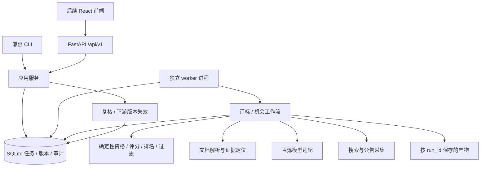

# FastAPI 模块化单体后端修复计划（Implementation Plan）

> **状态（2026-10-03）：R01–R11 已完成；第三批独立复核的 3 项重要问题已修复，144 项离线测试通过。** 两条业务链可经 API 完成上传、提交、复核、结果查询及报告导出；CLI 保持兼容。真实模型、OCR 和至少 10 组真实脱敏材料质量基线仍属后续验证。详见 [第一、第二批记录](2026-10-03-batches-1-2-progress.md) 与 [第三批记录](2026-10-03-batch-3-progress.md)。
> 执行记录：用户已授权第一、第二、第三批。执行时，使用 `superpowers:executing-plans` 按任务执行；每项先建立故障用例，再实现、验证和记录变更。

**Goal:** 修复现有评审结论与流程缺陷，形成能持久保存任务、人工复核和证据的 FastAPI 后端，为后续 React 提供稳定接口。

**Architecture:** 采用模块化单体：FastAPI 接口层、应用服务与工作流、领域规则、基础设施四层。评标与机会搜索共享文档、模型、数据库和审计能力；API 与独立任务执行进程属于同一代码库，在初期单机部署。React 只消费 API，资格、评分、排序和复核规则保留在后端。

**Tech Stack:** Python 3.11、FastAPI、Uvicorn、Pydantic v2、SQLAlchemy 2、Alembic、SQLite；保留百炼、现有 OpenAI 兼容调用、MarkItDown 和 HTTPX，OCR 后端按样本验证选择。React + TypeScript 是后续建议，本次不创建前端。

**Spec:** [现有架构评估与发现 F01–F20](2026-10-02-architecture-review-and-improvement-plan.md)。本计划收敛其修复与后端服务化范围，取代原文中“后续再决定 API 框架”的安排。

## 1. 已确定事项与规划假设

用户已确定：采用模块化单体方案；后端按 FastAPI 设计；为可能的 React 前端准备。2026-10-02 仅生成计划；2026-10-03 授权实施第一、第二、第三批。

规划假设：首版单机、小团队或单用户使用，数据库和任务执行进程位于同一台机器；默认本地访问。用户尚未要求远程多人部署、完整身份系统或前端开发，因此这些作为后续条件，不影响当前业务修复和 API 契约设计。

### 全局约束

- 保留两个现有 CLI 入口，但将交互与工作流分离，CLI 和 API 消费相同应用服务。
- 资格三态为 `passed / failed / needs_review`；缺信息不得隐式转为通过或不通过。
- 不通过资格仍允许参考评分，必须显式标为参考，不得进入有效推荐集合。
- 评分使用确认过的招标规则；模型不得自行修改权重、计算公式、资格状态和最终排名。
- 所有任务、企业、投标人、文档、公告均使用系统 ID；显示名称不参与路径构造或关联键。
- 首版使用 SQLite 与本机独立 worker，不先引入 Redis / Celery；多机或明显并发压力再迁移。
- React 不接收模型 API key、服务器绝对文件路径或未经筛选的模型原始响应。
- 所有修复测试默认离线，使用假模型与假搜索来源；真实模型测试显式启用。
- FastAPI、SQLAlchemy 和其他包在实施时选取经过 Python 3.11 联合验证的版本并锁定，不在计划中猜测精确版本。
- 执行状态按批次记录：R01–R11 已实现；React 尚未实施。真实模型、OCR 准确率不由模拟测试代替验收。

### Review Focus

1. 否定表达、未知资格和缺失证据：R02、R03、R04 必须阻止误推荐。
2. 上游内容修改、人工重排、重复提交、版本冲突：R02、R05、R09 必须保持 ID 和版本一致。
3. Worker 崩溃、API 重启、执行中取消、等待人工确认：R05、R08、R11 必须保留可恢复任务状态。
4. 扫描件、长文档、超大上传、非法路径和不支持的旧格式：R04、R09 必须明确失败或转复核。
5. 截止边界、预算单位、非招标公告、来源失败和空资格：R02、R10、R11 必须保留失败与复核原因。

## 2. 后端架构与职责



FastAPI 只做参数校验、依赖注入、HTTP 错误映射和响应序列化。按项目、文档、任务、复核、报告、企业划分 `APIRouter`，符合其多文件应用组织方式。[FastAPI 应用组织文档](https://fastapi.tiangolo.com/tutorial/bigger-applications/)

耗时任务由独立 worker 执行，提交请求返回 202 和 run_id。完整评标任务不依赖 HTTP 连接存活，也不依赖内存列表或 FastAPI `BackgroundTasks` 保存任务。官方说明重计算可考虑进程外任务工具；本项目采用“SQLite 持久任务 + 单机 worker”是当前规模下的设计选择，并非 FastAPI 自带任务队列。[FastAPI 后台任务说明](https://fastapi.tiangolo.com/tutorial/background-tasks/)

数据库和 HTTP 客户端的 API 侧初始化 / 关闭使用 `lifespan`；worker 单独管理自身资源，不在每个 Uvicorn 进程中自动拉起 worker。[FastAPI 生命周期文档](https://fastapi.tiangolo.com/advanced/events/)

### 2.1 建议目录

```text
src/ai_bid_evaluator/
  main.py / search_opportunity_main.py       兼容入口
  api/
    app.py                                  create_app 与 lifespan
    dependencies.py                         注入服务 / session
    errors.py                               HTTP 错误映射
    schemas.py                              请求和响应 DTO
    routers/
      projects.py documents.py runs.py
      reviews.py reports.py companies.py
  application/
    run_service.py                          创建 / 重试 / 取消任务
    document_service.py                     文档登记与读取
    review_service.py                       复核与版本失效
    report_service.py                       报告版本 / 导出
  domain/
    documents.py evaluation.py
    opportunity.py run.py                    Pydantic 领域模型
    exceptions.py                           领域错误
  rules/
    qualification.py scoring.py
    ranking.py opportunity_filter.py         确定性业务规则
  workflows/
    bid_evaluation.py                       可分步评标流程
    opportunity_discovery.py                可分步机会流程
  worker/
    main.py runner.py                       领取 / 续租 / 执行 / 恢复
  infrastructure/
    db.py orm_models.py                     SQLAlchemy 与 ORM
    repositories.py                         持久化适配
    artifacts.py                            原子写入与安全路径
  services/
    document_ingestion.py                   转换 / OCR / 分块
    llm_gateway.py                          类型化模型调用
    agent_client.py bailian_file_service.py  保留服务商适配
  agents/ prompts/ search_opportunity/       渐进式迁移现有实现
alembic/                                    数据库迁移
tests/unit/ tests/integration/ tests/api/    离线测试
frontend/                                   仅保留未来位置，不创建
```

应用服务不得依赖 FastAPI 的 Request / Response；领域规则不得依赖 ORM、终端 input 或 HTTP。只迁移需要的部分，避免在修复初期同时移动所有文件。

## 3. 数据与任务设计

### 3.1 存储

SQLite 通过 SQLAlchemy 2 管理，Alembic 记录迁移。API 请求和 worker 步骤各自创建、关闭 session，不跨请求或并发任务共享 session。[SQLAlchemy session 文档](https://docs.sqlalchemy.org/en/20/orm/session_basics.html)、[Alembic 文档](https://alembic.sqlalchemy.org/en/latest/tutorial.html)

初期数据库放在本机磁盘，启用外键和 WAL，写事务保持短小，模型调用期间不持有写事务。WAL 仍只有一个并发写入者，不能把 SQLite 当多机队列；数据库忙错误有界重试。[SQLite WAL 文档](https://sqlite.org/wal.html)

| 表 | 内容 |
|---|---|
| projects、bidders、companies | 项目、投标人和企业身份 |
| documents、document_chunks | 文件哈希、类型、角色、证据定位和解析状态 |
| runs、run_steps | 任务、输入快照、步骤、检查点、租约、重试与版本 |
| reviews | 原值、新值、理由、操作者标识、确认时间和 expected_version |
| evaluations、reports | 原始结果与程序确认结果、报告版本和 stale 标记 |
| run_events、audit_events | 可展示的进度事件与内部审计 |
| idempotency_keys | 重复提交键、请求摘要和已返回响应 |
| notices、notice_sources | 公告身份、类型、时效、多来源和版本关系 |

数据库保存关系、状态和索引；原文件及大型解析产物写在受控目录，用 document_id/run_id 命名。旧 data 输出通过显式导入工具转换，保留原文件，不将旧 JSON 直接视为当前有效报告。

### 3.2 任务状态与恢复

状态机：`pending → running → awaiting_review → pending → running → succeeded`；异常可转 `failed`；收到取消请求后在安全步骤边界转 `cancelled`。任务结果或报告的 `stale` 为版本有效性标记，独立于执行状态，避免“已成功但依据过期”无法表达。

- `awaiting_review` 持久保存检查点并释放 worker，不在 worker 中等待 `input()`。
- 人工确认后同一事务更新复核记录、结果版本和可继续任务状态；对 expected_version 不匹配返回冲突。
- 每步保存 input_hash、output_hash、model/prompt/schema_version，完成后再提交步骤状态。
- Worker 原子领取 pending 任务，保存 owner 和租约，并定时续租；初始一个 worker、一个运行中的任务，模型请求可受控并发 2。
- 崩溃后过期租约只恢复未完成步骤。临界崩溃可能导致模型请求重复；保证本地结果幂等，不承诺外部模型调用恰好一次。
- API 在事务中登记任务和输入快照后返回 202；worker 不可用时 pending 任务仍可查询。
- 重试只针对失败步骤；改规则或文档属于新修订，标记下游 stale，保留旧任务供审计。
- `cancel_requested` 可即时登记，执行中的模型请求可能先返回；之后不开始新步骤，已产生结果仍留存。

## 4. 面向 React 的 API 契约

统一前缀 `/api/v1`，首版分页 `limit=20`、最大 100，使用稳定游标。ID 为不透明字符串；时间用带时区的 ISO 8601；金额与精确分值按十进制字符串输出。数值规则由后端计算，前端仅展示。

列表结构为 `{items, next_cursor}`；错误结构为 `{error: {code, message, details, request_id}}`。校验错误保留字段路径，但不得附带密钥或服务器路径。成功响应使用各端点明确的 response_model。

| 方法 / 路径 | 行为 | 主要响应 |
|---|---|---|
| POST /projects | 创建项目 | 201 ProjectResponse |
| GET /projects | 项目历史分页 | 200 items / next_cursor |
| POST /projects/{id}/bidders | 登记稳定投标人 ID | 201 BidderResponse |
| POST /documents | multipart：project_id、role、可选 bidder_id、file；上传登记 | 201 DocumentResponse |
| GET /documents/{id} | 解析状态、质量与元数据 | 200 DocumentResponse |
| GET /documents/{id}/chunks | 带定位的证据块分页 | 200 items / next_cursor |
| POST /runs | type、project_id、文档 ID、画像 ID / 版本或画像源文档、搜索选项；提交任务 | 202 RunResponse + Location |
| GET /runs | 按项目、类型、状态查询 | 200 items / next_cursor |
| GET /runs/{id} | 阶段、复核需求、错误、结果版本 | 200 RunResponse |
| GET /runs/{id}/events | after_seq 后的持久进度事件 | 200 items / next_cursor |
| POST /runs/{id}/retry | 仅重试失败任务；带 expected_version | 202 RunResponse |
| POST /runs/{id}/cancel | 登记取消意图；带 expected_version | 202 或已终止时 200 |
| GET /runs/{id}/reviews | 所有待确认与历史复核记录 | 200 items / next_cursor |
| POST /runs/{id}/reviews | decision、target_id、patch、reason、expected_version | 201 ReviewResponse |
| GET /runs/{id}/results | 确定性结果与逐条证据矩阵 | 200 EvaluationResponse |
| GET /runs/{id}/reports | 报告版本列表 | 200 items / next_cursor |
| GET /reports/{id} | 报告内容、确认状态、stale 与版本 | 200 ReportResponse |
| GET /reports/{id}/export | format=json/markdown/html | 下载文件或 409 报告未就绪 |
| GET /companies、GET /companies/{id} | 企业与画像版本 | 200；完整档案更新属于后续任务 |
| GET /health/live、GET /health/ready | 存活、数据库与配置就绪 | 200 / 503 |

评标输入至少包含公告、招标文件及一名投标人的材料；机会搜索输入包含已确认画像或用于提取画像的材料。文档状态和类型不满足要求时在提交前返回明确错误。

任务创建必须带 `Idempotency-Key`；相同键和相同请求返回相同 run_id，相同键不同内容返回 409。复核 / 重试 / 取消同样使用此键保存响应，重放检查先于版本检查，避免浏览器重试被误判为冲突。

约定错误：400 业务参数组合错误；404 ID 不存在；409 版本、状态或幂等键冲突；413 上传超限；415 格式不支持；422 字段校验失败；503 数据库或必要配置不可用。异步执行失败写入任务错误，由 GET 查询，不把已经接收的请求事后改成 HTTP 错误。

### 4.1 前后端连接细节

- 首版以轮询 GET /runs/{id} 为基础，建议前台运行时 2 秒、后台标签页 10 秒；进入终态或 awaiting_review 后停止自动轮询，由用户操作触发刷新。SSE 留作优化，不作为最小验收依赖。
- RunResponse 包含 `run_id/type/status/current_step/completed_steps/known_steps/cancel_requested/review_count/revision/result_stale/error/created_at/updated_at`；未知总步骤时不制造百分比。
- 固定 operation_id 和 DTO 名称，从 OpenAPI 生成 TypeScript 客户端；在后端 CI 中检查 Schema 变化，前端开始时再选择并锁定生成器。[FastAPI 客户端生成文档](https://fastapi.tiangolo.com/advanced/generate-clients/)
- CORS 从配置读取明确 origin，开发建议 localhost:5173 和 127.0.0.1:5173；生产同源或配置实际前端地址。CORS 不替代访问身份验证。[FastAPI CORS 文档](https://fastapi.tiangolo.com/tutorial/cors/)
- 首版默认本机绑定；未来对外或多人访问时再加入身份验证、资源权限和审计身份，不依赖页面隐藏按钮控制复核权限。
- 上传默认上限 50 MiB，可配置；使用服务生成路径并做大小 / 内容检查。支持格式以已验证解析后端为准，旧 DOC 没有可用适配时返回 415，不能冒充 DOCX。
- 健康检查和 OpenAPI 导出不调用模型；开发 / 测试可注入 fake gateway，无密钥时仍能检查接口，执行真实模型任务时明确提示配置缺失。

## 5. 修复计划表

所有估算是单名熟悉 Python 的开发者的人日，包含对应测试，不含等待外部接口、真实样本和评审时间。任务编号为本修订计划的 R 编号；原评估 F 编号保持不变。

| ID | 优先级 | 交付 | 依赖 | 人日 | 验收目标 | 状态 |
|---|---|---|---|---|---|---|
| R01 | P0 | 工程基线、领域与 API 契约模型 | 无 | 2–3 | 安装可复现；三态和 ID 明确；无效输出可拦截 | 已完成 |
| R02 | P0 | 修复否定误推荐、文档兜底、结果关联和复核遗漏 | R01 | 1–2 | 已复现错误不再出现；人工重排不串数据 | 已完成 |
| R03 | P0 | 评分、资格门槛与报告事实校验 | R01、R02 | 2–3 | 越界无效；未知复核；模型不改变排名 | 已完成 |
| R04 | P1 | 统一文档摄取、分块和证据定位 | R01、R02 | 3–5 | 上传与本地输入一致；扫描 / 表格 / 长文档可诊断 | 已完成 |
| R05 | P1 | SQLAlchemy / Alembic、任务状态、版本与审计 | R01、R03 | 3–5 | 重启与人工修改可追溯；产物隔离；旧数据可导入 | 已完成 |
| R06 | P1 | 模型适配、重试、超时与用量 | R01、R05 | 1–2 | 假客户端验证限流、非法 JSON、取消和版本缓存 | 已完成 |
| R07 | P1 | FastAPI 应用、路由依赖与错误规范 | R01、R05 | 2–3 | lifespan、OpenAPI、健康检查、CORS、测试注入可用 | 已完成 |
| R08 | P1 | 独立 worker 与可恢复工作流 | R02、R03、R05、R06 | 2–4 | 持久提交后执行（HTTP 202 在 R09）；重启恢复；复核释放 worker；取消可控 | 已完成 |
| R09 | P1 | 上传、项目、任务、复核、证据与报告 API | R04、R07、R08 | 3–5 | 幂等、冲突、状态与下载接口契约一致 | 已完成 |
| R10 | P1 | 公告类型、截止、预算、地域与来源诊断 | R01、R02、R05 | 2–3 | 非招标 / 过期不推荐；未知值复核；来源可追溯 | 已完成 |
| R11 | P1 | 两条业务链 API 与恢复回归、后端验收文档 | R03–R10 | 2–3 | 全链无网络通过；OpenAPI 可生成客户端；CLI/API 一致 | 已完成 |

首批结论修复 R01–R03 约 **5–8 人日**；完整后端修复与 API 交付 R01–R11 约 **23–38 人日**。新增来源、完整企业档案、多租户、React 和真实通知均不计入此工期。

建议顺序：R01 → R02 → R03；然后完成 R04 / R05 → R06 / R07 → R08 → R09，并在验收前完成 R10；最后 R11。这是工作顺序建议，不表示本次已经派发并行任务。

## 6. 逐任务实施范围与验收

### R01：数据契约与工程基线

**对应发现：** F06–F08、F15、F19。

**文件：** 新增 `domain/{documents,evaluation,opportunity,run,exceptions}.py`、`pyproject.toml`、锁文件、开发依赖与 README；修改 config、json_utils、资格渲染与相关 prompts。先不迁移业务流程。

**接口责任：** 定义 DocumentInput、ParsedDocument、DocumentChunk、EvidenceRef、EvaluationRule、QualificationResult、ScoreResult、TenderNotice、OpportunityRequest、OpportunityAssessment、CompanyProfile、RunState、ReviewDecision、ProjectCreate、BidderCreate、RunCreate、RunResponse。QualificationResult.status 为三态；RunState.revision 整数，result_stale 布尔；钱款和分数 Decimal；HTTP DTO 不包含内部路径。

- [x] 用 `tests/unit/test_contracts.py` 测试未知枚举、非有限数字、列表顶层、错 ID、缺失证据及资格未知状态；缺失资格不能展示“不通过”。
- [x] 用 `tests/unit/test_prompt_examples.py` 检查报告示例 JSON，修复缺逗号与 final_score/total_score 不一致。
- [x] 实现显式旧 JSON 到新模型的兼容转换；Schema 验证不得通过默认值放行肯定结论。
- [x] 锁定联合验证的依赖，补 fake 客户端入口；`python -m pytest tests/unit/test_contracts.py tests/unit/test_prompt_examples.py -q` 全通过。

### R02：已知业务流程错误

**对应发现：** F01、F02、F04、F05、F09。

**文件：** 修改 main、公告 / 招标提取 agents、机会 orchestrator、searcher、models、suitability_agent；测试 `tests/unit/test_regressions.py`。

**接口：** `extract_requirements(document: DocumentInput, project_name: str) -> list[EvaluationRule]`；`normalize_suitability_result(result: dict, candidate_id: str) -> dict` 保留旧调用桥接；`SearchService.search(queries: list[str], *, max_candidates: int | None = None)`。

- [x] 先复现不推荐 / 不可行 / 不适合参与投标误转适合；修复明确映射，歧义复核。
- [x] 假上传失败时，公告、资格与评分标准提取必须收到本地内容；空 file_id 和空正文组合禁止模型请求。
- [x] 用 bidder_id 关联人工结果；删除、重复 ID、未知 ID 阻止继续，重排不会串投标人。
- [x] 缺资格候选写入最终复核集合；输入候选上限 2 / 8 生效；目标回归用例全通过。

### R03：确定性评分与报告

**对应发现：** F03、F06、F08、F20。

**文件：** 新增 rules/{qualification,scoring,ranking}.py；新增 reporting/{bid_report,opportunity_report}.py；修改 score_utils、报告 agents 和渲染。

**接口：** `validate_score_result(result: ScoreResult, rules: list[EvaluationRule]) -> ScoreResult`；`rank_bidders(qualifications: list[QualificationResult], scores: list[ScoreResult]) -> list[dict]`；两个 reporting 模块输出统一事实模型。

- [x] `tests/unit/test_scoring_rules.py` 覆盖 20/10、-1/10、NaN、重复或缺失评分项、父子满分冲突、缺价格参数；返回错误 / 复核，不标为通过。
- [x] 计算基于已确认规则，价格公式使用固定操作类型，不执行模型生成代码。
- [x] `tests/unit/test_report_integrity.py` 验证失败资格不推荐、未知资格复核、同分保留并列、参考分显式标记。
- [x] 模型仅生成说明；测试其改写数值、ID 或推荐时被发现；R01–R03 回归通过。

### R04：文档统一输入与证据

**对应发现：** F02、F17；借鉴 God Biao / Docling 的解析与定位思路。

**文件：** 新增 services/document_ingestion.py、解析后端适配；修改 markdown_loader 与提取 agents。

**接口：** `ingest_document(path: Path, document_id: str) -> ParsedDocument`；`chunk_document(doc: ParsedDocument, max_tokens: int) -> list[DocumentChunk]`。

- [x] `tests/unit/test_document_ingestion.py` 使用脱敏文本 PDF、扫描页、跨页表、XLSX、多页长文档及旧 DOC。
- [x] 保留页码 / 表格行列 / 块定位；OCR 失败与低质量结构化返回；按模型预算切块，无静默截断。
- [x] 对比 MarkItDown 与 pdfplumber 的页码/表格定位后采用 pdfplumber；无本地 OCR 引擎，提供可注入 OCR 与失败/置信度诊断，不把异常当正文。真实 OCR 后端选择与质量验收保留为部署前事项。
- [x] 输入方式一致；内容非空不等于可评审，低质量内容必须进入复核。

### R05：持久化和版本

**对应发现：** F13、F14；承载后端任务基础。

**文件：** 新增 infrastructure/{db,orm_models,repositories,artifacts}.py、alembic、application/{run_service,review_service,report_service}.py；新增旧数据导入命令。

**接口：** `RunService.create(request: RunCreate, idempotency_key: str) -> RunState`；`RunRepository.load(run_id: str) -> RunState`；`ReviewService.apply(run_id: str, decision: ReviewDecision, idempotency_key: str) -> RunState`；定义 repository 的任务领取 / 续租和步骤检查点操作。

- [x] `tests/integration/test_persistence.py` 覆盖事务回滚、数据库重开、任务隔离、幂等重复提交、旧 JSON 导入不覆盖原文件。
- [x] `tests/unit/test_review_versions.py` 覆盖 expected_version 冲突和改上游后下游 stale；记录前后值、理由和来源版本。
- [x] 初始 Alembic 迁移可建立测试库；升级前后验证任务 / 复核记录保留；SQLite 外键与短写事务通过测试。
- [x] 每次 API 请求 / worker 步骤独立 session；文件安全路径和原子写入可验证。

### R06：模型适配与失败处理

**对应发现：** F15、F16。

**文件：** 新增 services/llm_gateway.py；修改 agent_client、config；记录模型 / prompt / schema 版本、用量与输入哈希。

**接口：** `async generate_json(task: str, payload: dict, schema: type[BaseModel], documents: list[DocumentInput]) -> BaseModel`。

- [x] `tests/unit/test_llm_gateway.py` 用假客户端验证认证错误不重试、429 / 5xx 有界重试、超时与无效 JSON / Schema 分类。
- [x] 避免 SDK 和应用层重试相乘，客户端复用并关闭；原始文本不直接返回 API。
- [x] 缓存键包含版本及输入哈希；同内容不同规则 / 提示词版本不得错用结果。
- [x] API key 与全量文档不写常规日志；目标离线用例全部通过。

### R07：FastAPI 应用基础

**文件：** 新增 api/{app,dependencies,errors,schemas}.py 和健康路由；补 FastAPI、Uvicorn、python-multipart 与数据库所需依赖。

**接口：** `create_app(settings: Settings, overrides: dict | None = None) -> FastAPI`；所有 router 注入 R05 应用服务；设置 `lifespan`、request_id、异常映射和 operation_id。

- [x] `tests/api/test_app.py` 验证无需真实模型即可启动、live / ready、生命周期资源关闭和错误结构。
- [x] `tests/api/test_cors.py` 验证允许开发 origin，其他 origin 不获得允许响应头；不将 CORS 当身份系统。
- [x] 导出 OpenAPI Schema，验证全部 DTO、枚举、分页与错误响应可序列化。
- [x] 测试依赖覆盖后模型调用数为 0；默认本机地址，API 启动不拉起 worker。

### R08：独立 worker 与分步流程

**文件：** 新增 worker/{main,runner}.py、workflows/{bid_evaluation,opportunity_discovery}.py；现有入口委托应用服务。

**接口：** `async execute_next_step(run_id: str) -> RunState`；`claim_next(owner: str, now: datetime, lease_seconds: int) -> RunState | None`；`renew_lease(run_id: str, owner: str, now: datetime) -> None`；仓库在 R05 定义并实现这些领取接口。

- [x] `tests/integration/test_worker_recovery.py` 覆盖一个任务只被一个有效租约领取，过期租约按检查点恢复；API 重启不改变任务状态。
- [x] 人工检查点提交 awaiting_review 后释放租约，worker 能执行另一 pending 任务；不等待终端输入。
- [x] `tests/integration/test_cancel_retry.py` 验证取消登记、安全边界终止、失败步骤重试与已完成步骤不重跑。
- [x] 初始租约 120 秒、每 30 秒续租，可配置并使用假时钟测试；阻塞解析放受控线程或子进程，不能阻塞续租。
- [x] 外部调用临界重复可追踪，步骤输出幂等；关闭 worker 期间应用服务仍可读取 pending / running 记录；HTTP GET 由 R09 验收。

### R09：业务 API 与前端契约

**文件：** 新增 api/routers/{projects,documents,runs,reviews,reports,companies}.py、application/document_service.py；消费 R05、R08 接口，不重复业务规则。

**接口：** 第 4 节 REST 表为首版接口范围；DTO 在 api/schemas.py，领域到 DTO 的转换不暴露内部字段。company 列表只读取已提取档案，完整增量更新留后续。

- [x] `tests/api/test_uploads.py` 验证 50 MiB 边界、格式不支持、文件名路径穿越、重复文件、文档角色与 bidder_id 关联；无法解析材料进入明确错误。
- [x] `tests/api/test_runs.py` 验证 202、Location、幂等键冲突、状态查询、取消 / 重试合法状态与版本冲突。
- [x] `tests/api/test_reviews.py` 验证复核理由、改分上下界、请求重放与审计；全部关键 unknown 被确认前不能生成已确认最终报告。
- [x] `tests/api/test_reports.py` 验证证据定位、下载内容、stale 提示及结果 ID / 数值一致；明确草稿与已确认状态。
- [x] `tests/api/test_openapi_contract.py` 验证固定 operation_id、枚举、日期和十进制字符串；前端需要的错误 / 加载 / 空状态均可由契约表达。

### R10：机会筛选完整性

**对应发现：** F10–F12、F18 的画像输入限制；完整多材料画像资产化暂缓。

**文件：** 新增 rules/opportunity_filter.py；修改公告提取、候选与搜索来源模型；保存 notices / notice_sources。

**接口：** `filter_notice(notice: TenderNotice, request: OpportunityRequest, now: datetime) -> OpportunityAssessment`；`canonicalize_url(url: str) -> str`，不把完整 URL 一律小写。

- [x] `tests/unit/test_opportunity_filters.py` 验证中标 / 终止 / 过期、截止等于 now、万元换算、地域不匹配、未知预算和更正公告。
- [x] 不把查询词当确定性地域预算证据；空资格和画像不足始终进入复核集合。
- [x] `tests/unit/test_source_identity.py` 验证保留 provider、路径大小写、项目编号与标段、区分成功无结果和源失败。
- [x] 继续支持当前来源，新增站点不作为首版修复通过条件。

### R11：后端验收与 React 交接资料

**文件：** 新增 tests/integration/test_api_workflows.py、test_cli_api_parity.py、test_restart_recovery.py；新增 docs/backend-api.md 和脱敏 fixtures；更新 README 启动 / 迁移 / 恢复说明。

- [x] 假模型完整跑两条链：上传 → 提交 202 → worker → 复核 → 继续 → 确定性结果 → 报告。
- [x] 覆盖上传兜底、非法 JSON、两投标人重排、空资格、API 重启、worker 崩溃、重复提交、取消和失效报告。
- [x] 同输入通过 CLI / API 得到相同资格状态、分数、排名与复核点；无网络且无真实模型额度消耗。
- [x] 输出 OpenAPI 与请求 / 响应示例，验证能生成类型客户端；文档给出轮询 / 复核 / 冲突处理流程。
- [x] 验收命令 `python -m pytest tests/unit tests/integration tests/api -q`，全部通过；另检查数据库迁移和 API / worker 启停。
- [x] 真实脱敏材料至少 10 组作为后续质量基线，不能把模拟链通过当成模型或 OCR 准确率已达标。

## 7. 分批验收与后续范围

| 批次 | 范围 | 交付判断 |
|---|---|---|
| 第一批：结论修复 | R01–R03 | 所有已知误推荐与评分校验故障回归通过 |
| 第二批：可恢复后端 | R04–R08 | 文档有证据，任务可持久化，API 与 worker 独立，复核可恢复 |
| 第三批：API 可供前端使用 | R09–R11 | 两条链可经 API 完成，契约 / 错误 / 版本 / 导出明确 |
| 后续 React（可选） | 上述后端验收后 | React + TypeScript 接类型客户端，做上传、进度、证据核对、比较和人工复核 |
| 后续业务扩展（可选） | 核心质量基线建立后 | 企业多材料增量画像、新来源、订阅与通知、多人权限 |

React 阶段建议 4–6 人日作为起步估算，不计后端工期；UI 需另有页面和交互设计。不得在 frontend 再实现分值计算或资格判定；材料改变和改分导致报告过期必须由后端明确返回。

## 8. 初始计划交付记录（2026-10-02，保留历史）

- 本次更新旧评估文档中的方案选择说明，新增本修复计划；业务代码、依赖、数据库均未改动。
- 初始方案二已经选择；后续 React 尚为可选，当前后端明确为 FastAPI。
- 原发现 F01–F20 已映射：R01 对应契约 / 工程；R02 对应控制流；R03 对应评分 / 推荐；R04 对应文档；R05/R08 对应状态；R06 对应模型；R10 对应搜索。F18 的完整企业档案管理保留在后续业务扩展，首版仅允许画像源材料或已确认画像作为机会输入。
- 所有接口类型有责任模块；任务依赖无环；各任务均有具体测试文件、断言目标和交付边界。
- FastAPI 框架事实引用官方文档；单机 worker、SQLite 任务队列、API 路径和轮询频率均为本项目设计选择。
- 上轮 24 项离线检查属于已有分析证据，本次没有重复运行业务测试，也不声称修复或 API 已实现。
- 全部实施复选框未选中，等待后续实施指令。

## 9. 第一、第二批实施验收（2026-10-03）

- R01–R08 实现、CLI 迁移和最终复核修复完成；99 项离线测试通过，锁定依赖在全新 Python 3.11 环境可安装，pip check 无冲突。
- wheel 构建、非 editable 安装及随包 Alembic 迁移验证通过；真实本机 HTTP 健康检查、worker 空队列单次启动/退出已验证。
- 五项 Important 复核缺陷均有失败优先的回归测试：拒绝后重试、无证据失败、独立报价、跨块评分、画像及机会证据。
- OCR 无引擎时转复核，跨块评分不确定时须人工汇总；真实模型、中文 OCR 和复杂跨页表格准确率未验证。
- 业务 HTTP 路由、公告时效/预算/地域过滤、完整 API 验收与 React 保持后续范围。

## 10. 第三批实施验收（2026-10-03）

- R09–R11 已完成，完整测试集 144 项通过；计划指定 unit/integration/api 测试集 133 项通过。
- 22 个固定 OpenAPI operation_id，19 条路径，35 个 Schema；引用解析、TypeScript 类型生成和 strict 客户端示例编译通过。
- wheel 构建/非 editable 安装、依赖检查、实际本机 HTTP 上传/提交/取消与独立空队列 worker 启停通过；验证服务已停止。
- 独立复核 3 项 Important 均以 RED→GREEN 回归修复：完整截止标签、人工补录证据持久化、企业画像并发版本冲突；无 Critical 或遗留 Minor。
- React、真实模型/OCR质量、至少10组真实脱敏材料、远程身份权限和自动历史公告监测仍为后续范围；未创建 Git 提交或 PR。
- 详见 [第三批实施记录](2026-10-03-batch-3-progress.md) 和 [后端 API 文档](../../backend-api.md)。
